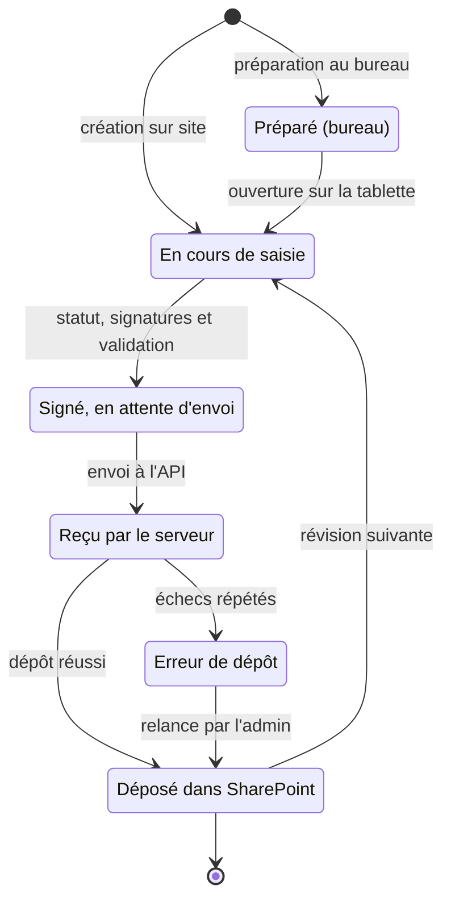
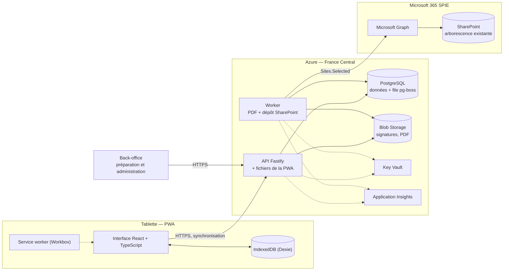
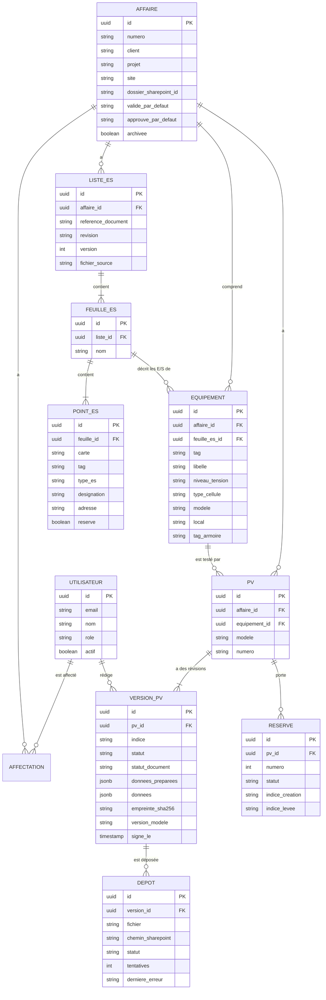

# Spécification — Plateforme tablette de saisie des PV SPIE

> Version 0.4 — brouillon — 19/11/2026
> v0.2 : intégration du modèle « PV de test relais de protection » (`exemple PV.docx`) et de la liste d'entrées/sorties `GAU11_AUT_009` (affaire A35173).
> v0.3 : N° Document inchangé, logos fixes, E/S de réserve en NA, pas de conclusion par fonction, aucun autre modèle existant.
> v0.4 : réception et intervention sorties de la V1. La V1 porte uniquement sur le PV de test relais de protection.
> Les éléments marqués **[À FOURNIR]** ou **[À VALIDER]** sont repris en section 12.

---

## 1. Contexte et objectifs

### 1.1 Contexte

Les techniciens SPIE établissent des procès-verbaux (PV) : réception de travaux, mise en service et essais, intervention et maintenance. Ces PV sont aujourd'hui des documents Word, comme le modèle « PV de test relais de protection » fourni. Ils sont préparés au bureau, complétés lors des essais, puis rangés à la main dans SharePoint **[À VALIDER]**. Cela entraîne :

- de la ressaisie et des délais de classement ;
- des erreurs de rangement et des PV incomplets ;
- un suivi difficile des réserves et des vérifications d'entrées/sorties et de remontée SCADA, point par point.

### 1.2 Objectifs

1. Préparer les PV au bureau, en les pré-remplissant à partir des données d'étude (liste des équipements, liste des entrées/sorties, réglages).
2. Compléter les PV sur tablette, **y compris sans réseau**.
3. Faire signer le PV sur la tablette par SPIE et par le représentant du client.
4. Produire un PDF **fidèle aux modèles SPIE existants** (bilingue FR/EN), accompagné des données structurées (JSON, Excel).
5. Déposer automatiquement les fichiers au bon endroit dans **l'arborescence SharePoint existante**.
6. Garder la trace des révisions successives d'un PV (levée de réserves, correction).

### 1.3 Périmètre V1

- Un seul modèle : le **PV de test relais de protection** (famille Mise en service / essais), un PV par relais.
- **Hors V1** : réception de travaux et intervention / maintenance. Il n'en existe aucun modèle, ils seront conçus avec SPIE dans une version ultérieure (voir 4.5 et 10).
- Contenus : identification, mesures et injections, fonctions de protection, **vérification des entrées/sorties et de la remontée SCADA**, observations et réserves, conclusion, signatures manuscrites.
- Une PWA tablette pour les techniciens. Un back-office web pour la préparation des PV et l'administration.
- Pilote avec **moins de 20 utilisateurs terrain**.

### 1.4 Indicateurs de succès

| Indicateur | Cible |
|---|---|
| PV du pilote complétés sur tablette | 100 % (zéro papier, zéro Word) |
| PV perdus (fermeture de l'appli, redémarrage, plusieurs jours hors ligne) | 0 |
| PV déposés au mauvais endroit dans SharePoint | 0 |
| Délai entre le retour du réseau et le dépôt SharePoint | < 15 min |
| Conformité visuelle des PDF aux modèles SPIE | Validée par SPIE pour chaque modèle |

### 1.5 Choix structurants

| Sujet | Choix | Justification |
|---|---|---|
| Type d'application | **PWA** (application web installable) | Parc de tablettes mixte (iPad, Android, Windows) : un seul code, aucune distribution par store |
| Hors ligne | **Obligatoire** | Réseau souvent absent sur site (sous-sols, locaux techniques) |
| Préparation | **PV pré-rempli au bureau, un par équipement, modifiable sur site** | La majorité du modèle (identification, réglages, valeurs à injecter, liste des E/S) est connue avant les essais |
| Validation | **Pas de circuit de validation** dans l'appli. Les noms « Écrit / Validé / Approuvé par » sont renseignés | Choix SPIE. Le PV est déposé dès sa signature |
| Authentification | **Comptes propres à l'application** | Choix SPIE. Rend un backend indispensable |
| Backend | **Node.js / TypeScript** sur **Azure** | Même langage que le front (types partagés). Azure est dans l'écosystème de SharePoint |
| Back-office | **Oui**, intégré à la même application web | Indispensable pour importer les listes E/S et préparer les PV |
| Sortie | **PDF + JSON**, et **XLSX** pour les résultats des E/S | PDF pour l'archivage et la signature, données pour l'exploitation |
| Langue | Interface en **français**, PDF **bilingues FR/EN** comme les modèles | Les modèles SPIE actuels sont bilingues |
| Numérotation | **N° d'affaire + date et heure de création**, identifiant du PV. Le « N° Document » du modèle garde la codification projet | Règle SPIE. La tablette attribue le numéro seule, sans réseau ni échange avec le serveur |
| Révisions | **Indice explicite** (A, B, C…), reporté dans le tableau des révisions du PV et dans le nom de fichier | Usage SPIE (Rév A, B…). Chaque révision signée reste visible et ne change plus |
| Génération PDF | **Modèles HTML/CSS partagés**, PDF rendu par Chromium côté serveur | Rendu fidèle. Les tableaux longs (E/S) se répartissent correctement sur plusieurs pages. Le même modèle sert à l'aperçu hors ligne sur la tablette |
| Écriture SharePoint | **Microsoft Graph**, identité applicative avec **`Sites.Selected`** | Le droit d'écriture est limité au seul site cible |

---

## 2. Utilisateurs et rôles

| Rôle | Qui | Accès | Droits |
|---|---|---|---|
| **Technicien** | Technicien SPIE sur le terrain | PWA sur tablette | Ouvre les PV préparés qui lui sont affectés et les complète, y compris en corrigeant les valeurs pré-remplies. Choisit le statut BPO / BPE / CMS et fait signer. Peut créer sur site un PV pour un équipement non préparé. Crée la révision suivante d'un PV de ses affaires |
| **Préparateur** | Ingénieur, chargé d'affaires | Back-office (navigateur, poste fixe) | Importe les listes d'E/S. Crée et pré-remplit les PV par équipement, puis les affecte aux techniciens. Suit l'avancement et les dépôts |
| **Administrateur** | Référent outil | Back-office | Tous les droits du préparateur. Gère aussi les comptes, les affaires, le paramétrage SharePoint et la relance des dépôts en erreur |
| **Signataire client** | Représentant du client ou du maître d'ouvrage | Aucun compte | Signe sur la tablette du technicien (date, nom, visa, commentaires) |

---

## 3. Parcours principaux

### 3.1 Préparation (au bureau, réseau disponible)

1. L'administrateur crée l'affaire : numéro d'affaire (ex. `A35173`), client, projet, site, **dossier SharePoint cible**. Il ajoute les noms par défaut « Validé par » et « Approuvé par ». Il affecte les techniciens.
2. Le préparateur importe la **liste des entrées/sorties** de l'affaire (Excel, voir 4.4). Les équipements de l'affaire et leurs E/S sont créés.
3. Pour chaque équipement à tester, le préparateur crée un PV à partir du modèle (par exemple « PV de test relais de protection »). Il pré-remplit :
   - le N° Document (codification projet SPIE, ex. `GAU11_AUT_009`) ;
   - l'identification du relais, les caractéristiques TP/TC, le fichier de paramétrage ;
   - les valeurs à injecter et les fonctions de protection avec leurs réglages ;
   - l'affectation des LED, le matériel de test, les documents de référence.
   La liste des E/S est reprise automatiquement de la feuille correspondant à l'équipement.
4. Le préparateur affecte le PV à un ou plusieurs techniciens.
5. Le technicien ouvre l'application. Ses affaires, PV préparés et modèles sont téléchargés sur la tablette, qui affiche « **Prêt pour le hors ligne** » avec la date de dernière synchronisation.

### 3.2 Saisie sur site (hors ligne)

1. Le technicien ouvre un PV préparé. Il peut aussi en créer un pour un équipement de l'affaire qui n'a pas été préparé : seule la liste des E/S est alors pré-remplie.
2. Il complète le PV section par section : valeurs mesurées, conclusions C / NC / NA, E/S, temps de déclenchement, messages lus en supervision, observations. Chaque modification est **enregistrée localement** immédiatement.
3. Il peut corriger une valeur pré-remplie. La valeur préparée est conservée et la modification est tracée (voir 4.2).
4. Avant signature, l'application liste ce qui manque : champs obligatoires, E/S non testées, conclusions absentes, NC sans observation.
5. **Aperçu** du PV dans le format du modèle (même rendu que le PDF final).
6. Le technicien choisit le **statut du document : BPO, BPE ou CMS**, et la conclusion générale (matériel accepté ou refusé).
7. Signature SPIE, puis signature client (date, nom, visa, commentaires).
   - Cas du client qui refuse de signer : mention « Refus de signer », date et motif.
8. Validation : le PV est **figé** (plus modifiable). Ses données sont hachées (SHA-256) et il passe dans la file d'envoi.

### 3.3 Synchronisation et dépôt

1. Au retour du réseau, la file d'envoi transmet les PV signés à l'API. L'envoi se déclenche à l'ouverture de l'application, quand le réseau revient, ou par le bouton « Synchroniser ».
2. L'API vérifie l'empreinte et enregistre le PV. Elle génère le PDF et le XLSX des E/S, puis dépose les fichiers dans SharePoint.
3. Le statut remonte sur la tablette : **Déposé**, avec un lien vers le fichier dans SharePoint.
4. En cas d'échec du dépôt (droits, dossier introuvable, SharePoint indisponible) :
   - reprises automatiques avec un délai croissant ;
   - puis alerte dans le back-office. L'administrateur corrige la cause et relance le dépôt.

### 3.4 Réouverture et révision suivante

1. Depuis un PV déposé, le technicien choisit « **Créer la révision suivante** ». Cette action demande du réseau : le serveur réserve l'indice et verrouille le PV, ce qui empêche deux modifications en parallèle.
2. La nouvelle révision reprend toutes les données de la précédente. Les signatures et le statut BPO / BPE / CMS sont vidés.
3. Une ligne est ajoutée au tableau des révisions : indice, date, auteur, « Validé par » et « Approuvé par » (repris par défaut), description de la modification.
4. Cas typique, la **levée de réserves** : le technicien marque les réserves levées, avec la date et un commentaire.
5. La nouvelle révision est signée puis déposée comme un nouveau PV. **Les révisions précédentes restent dans SharePoint, inchangées.**
6. On peut préparer la réouverture au bureau, puis remplir la révision hors ligne sur site.

---

## 4. Exigences fonctionnelles

### 4.1 Éléments communs à tous les PV

D'après le modèle fourni :

| Élément | Contenu |
|---|---|
| En-tête (chaque page) | Logos SPIE (fixes, repris du modèle Word), titre bilingue (ex. « PV DE TEST RELAIS DE PROTECTION / TEST SHEET PROTECTION RELAY »), N° Document, N° AFF, statut **BPO / BPE / CMS** (cases à cocher), projet, révision |
| Page de garde | Client, projet, **tableau des révisions** : Rév, date, écrit par, validé par, approuvé par, modifications |
| Sommaire | Généré automatiquement, avec numéros de page |
| Pied de page (chaque page) | « Page x sur y », mention de confidentialité, entité SPIE (« SPIE Industrie – Département Production Énergie »), fixe |
| Observations | Tableau : N°, libellé du contrôle, NA / C / NC, n° de réserve, observations |
| Conclusion générale | Matériel accepté / refusé |
| Signatures | Deux colonnes, SPIE Industrie et Client : date, nom, visa / signature, commentaires |

**Statut du document** :

- **BPO** : Bon Pour Observation.
- **BPE** : Bon Pour Exécution.
- **CMS** : Conforme à la Mise en Service.
- Le technicien le choisit au moment de la signature.

**Noms du tableau des révisions** :

- « Écrit par » : le technicien qui signe, par défaut.
- « Validé par » et « Approuvé par » : les noms par défaut de l'affaire.
- Tous sont modifiables. Ce ne sont que des noms : il n'y a pas de circuit de validation dans l'application.

**Numérotation** :

- Numéro du PV = **numéro d'affaire + date et heure de création du PV** : `<n° affaire>-<AAAAMMJJ>-<HHMMSS>`.
  - Exemple : `A35173-20261119-143205` pour un PV créé le 19/11/2026 à 14 h 32 min 05 s.
  - Format exact (séparateurs, secondes) **[À VALIDER]**.
- Ce numéro **identifie le PV** dans l'application, le JSON et les noms de fichiers. Il ne remplace pas le champ « N° Document » du modèle. Ce champ garde la codification projet SPIE (ex. `GAU11_AUT_009`) et est saisi à la préparation.
- Pour un PV préparé au bureau, le numéro est fixé à la **création par le préparateur**. Pour un PV créé sur site, il est fixé à la création sur la tablette, sans réseau.
- Le numéro reste le même d'une révision à l'autre.
- Heure locale française (Europe/Paris). Les tablettes et postes doivent être à l'heure automatique (imposée par MDM si possible).
- **Doublons** :
  - Une même tablette ne peut pas créer deux PV dans la même seconde : l'application attend la seconde suivante.
  - Il est très improbable que deux postes créent un PV sur la même affaire à la même seconde. Si cela arrive, le serveur le détecte et alerte l'administrateur.
  - Les secondes sont gardées pour cette raison : à la minute près, deux techniciens qui commencent leurs PV ensemble obtiendraient le même numéro.

### 4.2 Blocs de saisie

Les modèles sont construits à partir des blocs suivants. Chaque champ est soit **pré-rempli** (préparation), soit **saisi** (site), soit les deux : pré-rempli puis corrigeable.

| Bloc | Exemple dans le modèle | Pré-rempli | Saisi sur site |
|---|---|---|---|
| Texte fixe bilingue | Introduction, glossaire | Dans le modèle | — |
| Liste éditable | Matériel de test, documents de référence | Oui | Corrigeable |
| Fiche d'identification (libellé / valeur) | Identification du relais : modèle, n° de série, code de commande, adresse IP, tension auxiliaire, option, fréquence, communication | Oui | Compléments, corrections |
| Contrôle avec relevé | Tests préliminaires : tension auxiliaire, continuité de terre, mise à l'heure | Libellé | Valeur relevée + C / NC / NA |
| Tableau d'injection | Système équilibré / déséquilibré, circuits défaut terre : par phase, valeurs injectées (amplitude, angle) → valeurs lues sur le relais | Valeurs injectées | Valeurs lues + conclusion C / NC |
| Caractéristiques | Rapports TP / TC, classe, puissance, sens de câblage | Oui | Vérification C / NC |
| Fonction de protection (répétable) | Plan de protection : nom logique (ex. `PHPTOC1`), libellé, code ANSI, Ex, Gr.P, réglages, courbe, temps, valeurs injectées | Oui | Temps mesurés (protection, alarme, déclenchement), LED et sorties constatées, messages IHM / supervision, commentaires |
| Tableau d'affectation | Affectation des LED (n°, couleur, désignation) | Oui | Vérification |
| Tableau des E/S | Affectation cartes E/S (voir 4.4) | Import Excel | Résultats par E/S |
| Observations, conclusion, signatures | Voir 4.1 | — | Oui |
| Image | Schéma type d'installation | Dans le modèle | — |

**Règles de saisie** :

- Jugements : **C** (conforme), **NC** (non conforme), **NA** (non applicable), selon le glossaire du modèle.
- Les champs de mesure ouvrent un pavé numérique. Amplitude et angle sont saisis séparément.
- Un **NC** demande une observation **[À VALIDER]**. Il peut être transformé en réserve en un geste.
- **Modification d'une valeur pré-remplie** : la valeur préparée est conservée dans le JSON. La modification (auteur, date) est signalée dans le back-office. Elle peut aussi être signalée dans le PDF **[À VALIDER]**.

### 4.3 Réserves

Dans le modèle de test relais, les réserves apparaissent dans le tableau **Observations** (colonne « Réserve / Suspend »).

| Champ | Détail |
|---|---|
| N° | Attribué automatiquement dans le PV |
| Contrôle concerné | Libellé du contrôle ou de l'E/S d'origine |
| Description | Observation |
| Criticité | Par exemple bloquante / non bloquante **[À VALIDER]** |
| Responsable de la levée | Texte ou liste |
| Date prévue de levée | Date |
| Statut | Ouverte / Levée |
| Levée | Date, commentaire, indice de la révision qui l'a levée |

- Les réserves sont reportées d'une révision à l'autre.
- Le PV affiche un récapitulatif : nombre de réserves ouvertes et levées.

### 4.4 Vérification des entrées/sorties et de la remontée SCADA

L'objectif est de vérifier, E/S par E/S, que chaque signal du relais fonctionne et remonte correctement dans la supervision.

**Fichier source** : la « Liste entrées / sorties » de l'affaire. Exemple fourni : `GAU11_AUT_009_LISTE ENTREES SORTIES RPN_B.xlsx`, affaire A35173, révision B.

| Feuille | Contenu | Usage à l'import |
|---|---|---|
| `PdG_Client` | Page de garde : client, projet, révisions | Lue pour la référence et la révision du document |
| `REV` | Historique des révisions, n° document, n° affaire | Contrôle : le n° d'affaire doit correspondre à l'affaire |
| `LISTE DES EQUIPEMENTS` | Une ligne par équipement : libellé, type (HTA / HTB), type cellule, TAG, équipement, modèle, local, tag armoire, référence constructeur | Crée les **équipements** de l'affaire |
| Une feuille par type de cellule ou tranche (`TYPE ARRIVEE TR1`, `TYPE BATTERIE`, `TYPE TR AUX`, `HTB-TL`, `HTB_TR1`, `HTB_RGU`) | En-tête en ligne 6, données à partir de la ligne 7 : CARTES, TAG CELLULE / EQUIPEMENT (ou TAG RPN), TYPE, COMMENTAIRE, ADRESSE | Crée les **E/S**. Une même feuille sert à plusieurs équipements (ex. les 5 départs batterie) |

**Import (back-office)** :

- **Association équipement ↔ feuille** : faite automatiquement via la colonne « TYPE CELLULE » (ex. `TYPE BATTERIE` → feuille `TYPE BATTERIE`). Quand elle ne suffit pas, le préparateur choisit la feuille à l'import. C'est le cas des relais HTB, tous de type « HTB » (feuilles `HTB-TL` et `HTB_TR1`), et du régulateur de tension, dont le type cellule est vide (feuille `HTB_RGU`).
- **Normalisation des types** : les libellés varient d'une feuille à l'autre et sont ramenés à trois valeurs :
  - `ENTREE TOR` / `E TOR` → **Entrée TOR** ;
  - `SORTIE TOR` / `S TOR` → **Sortie TOR** ;
  - `ENTREE ANALOGIQUE` / `E ANA` → **Entrée analogique**.
- **Contrôles**, signalés ligne par ligne :
  - adresses en double dans une feuille (ex. `Q 01` deux fois dans `HTB_TR1`) ;
  - libellés d'équipement en double (ex. « DEPART F5 » pour `RPN_HTA_F4` et `RPN_HTA_F5`) ;
  - équipements sans feuille d'E/S correspondante (ex. `RPN_HTB_MCN_TR`, protection bobine point neutre) ;
  - types inconnus ;
  - lignes incomplètes.
  Les colonnes sans en-tête sont ignorées.
- **E/S de réserve** : les lignes dont le commentaire est `RESERVE` ou `RESERVE CABLEE` sont importées, marquées comme réserves et **cochées NA** automatiquement.
- La référence (`GAU11_AUT_009`) et la révision (`B`) du fichier sont mémorisées. Chaque import crée une **nouvelle version** de la liste. Un PV garde la version qu'il a utilisée.
- Volumes constatés : de 33 à 128 E/S par feuille.

**Saisie sur tablette**, pour chaque E/S :

| Colonne | Valeurs |
|---|---|
| Carte, adresse, type, désignation | Reprises de la liste (lecture seule) |
| Testé / validé | **C / NC / NA** |
| LED activées | **OK / NOK** |
| Relais activés | **OK / NOK** |
| Remontée SCADA | **C / NC** |
| Message lu en supervision | Texte (libellé affiché dans l'IHM / SCADA) |
| Commentaire | Texte libre |

- La date, l'heure et l'auteur sont ajoutés automatiquement à chaque saisie.
- Liste virtualisée, regroupée par carte. Recherche par adresse ou désignation. Filtres : non testées, NC, réserves.
- Compteur d'avancement : E/S testées sur total, nombre de NC.
- Une E/S en NC peut être transformée en réserve.

**Restitution** :

- Le tableau des E/S du PDF suit les colonnes ci-dessus. Il est plus riche que le tableau actuel du modèle, qui n'a pas de colonnes SCADA.
- Fichier **XLSX** déposé à côté du PDF : la feuille d'E/S de l'équipement, complétée des colonnes de résultats.

### 4.5 Modèles de PV

#### PV de test relais de protection (fourni)

Famille Mise en service / essais, un PV par relais. Structure du modèle (13 pages dans l'exemple) :

| § | Section | Pré-rempli au bureau | Saisi sur site |
|---|---|---|---|
| — | Page de garde, tableau des révisions | Client, projet, noms | Date, modification |
| 1–2 | Introduction, glossaire | Texte fixe | — |
| 3 | Généralités : objet, lieu des tests, dates | Objet | Lieu, dates |
| 4 | Matériel de test | Liste | Corrections |
| 5 | Documents de référence | Procédure, norme | — |
| 6 | Identification du relais | Modèle, code de commande, IP, communication… | N° de série, compléments |
| 7 | Tests préliminaires | Libellés | Relevés + C / NC / NA |
| 8 | Identification de la configuration | Nom du fichier de paramétrage | Vérification |
| 9 | Vérification des circuits de mesure : TP / TC, sens de câblage, système équilibré, système déséquilibré, circuits défaut terre | Caractéristiques, valeurs injectées | Valeurs lues, conclusions |
| 10 | Affectation cartes E/S, affectation LED | Liste E/S (import), LED | Résultats (voir 4.4) |
| 11 | Plan de protection : un bloc par fonction | Fonctions, réglages, valeurs injectées | Temps mesurés, LED / sorties, messages, commentaires |
| 12 | Observations | — | Oui |
| 13 | Conclusion générale, signatures | — | Oui |

#### Autres familles — hors V1

SPIE n'a pas d'autre modèle. Les familles ci-dessous sont **sorties de la V1**. Leurs modèles seront conçus avec SPIE (contenu et mise en page) dans une version ultérieure. Le moteur de modèles (4.2, 8.2) permettra de les ajouter sans refonte.

| Famille | Code | Contenu pressenti |
|---|---|---|
| Réception de travaux | `REC` | En-tête, checklist de réception, réserves, décision (sans réserve / avec réserves / refusée), signatures |
| Intervention / maintenance | `INT` | Nature (préventive / corrective), demande, travaux réalisés, heures d'arrivée et de départ, pièces remplacées, suites à donner, signatures |

Le régulateur de tension (`RGU_HTB_TR`) n'a pas de modèle de PV. Sa liste d'E/S est importée, mais aucun PV n'est prévu pour lui tant qu'un modèle n'existe pas.

### 4.6 Back-office

| Fonction | Détail |
|---|---|
| Utilisateurs | Création, désactivation, rôle, réinitialisation du mot de passe (mot de passe provisoire à changer à la première connexion) |
| Affaires | Création, modification, archivage. Techniciens affectés. Noms par défaut « Validé par » et « Approuvé par ». **Dossier SharePoint cible**, choisi en parcourant le site |
| Paramétrage SharePoint | Chemin relatif par famille de PV, sous le dossier de l'affaire |
| Listes E/S | Import, association équipement ↔ feuille, historique des versions, rapport d'anomalies |
| Équipements | Liste issue de l'import, avec l'avancement des tests par équipement |
| **Préparation des PV** | Création d'un PV par équipement à partir d'un modèle. Pré-remplissage avec le même formulaire que la tablette, en mode « préparation ». Duplication d'un PV préparé vers d'autres équipements de même type. Affectation aux techniciens |
| Suivi des PV | Liste filtrable (affaire, équipement, modèle, statut, technicien), consultation du PDF, valeurs pré-remplies modifiées sur site, statut de dépôt, **relance** des dépôts en erreur |
| Journal d'audit | Connexions, actions sur les PV, actions d'administration |

La duplication est utile car plusieurs équipements partagent les mêmes réglages. Par exemple, les 5 départs batterie de l'affaire A35173.

---

## 5. Sorties et dépôt SharePoint

### 5.1 Fichiers produits

| Fichier | Contenu | Produit |
|---|---|---|
| `.pdf` | Rendu fidèle du modèle SPIE (bilingue), signatures incrustées, sommaire paginé, en-têtes et pieds de page, empreinte | Toujours |
| `.json` | Toutes les données : valeurs préparées et valeurs saisies, version du schéma, version du modèle, version de la liste E/S, empreinte, métadonnées (auteur, horodatages, identifiant de la tablette) | Toujours |
| `.xlsx` | Feuille d'E/S de l'équipement + résultats E/S par E/S | Si le PV contient un tableau des E/S |

### 5.2 Emplacement dans SharePoint

L'application doit respecter **l'arborescence SharePoint existante [À FOURNIR]**. Principe proposé :

- Chaque affaire a un **dossier racine** dans SharePoint, choisi par l'administrateur.
- Chaque famille de PV a un **chemin relatif** configurable, par exemple `03 - Mise en service/PV`.
- Dossier de dépôt = dossier racine de l'affaire + chemin relatif de la famille.
- Si un sous-dossier manque, il est créé automatiquement ou le dépôt passe en erreur **[À VALIDER]**.
- Les fichiers JSON et XLSX sont déposés à côté du PDF, ou dans un sous-dossier dédié si SPIE préfère ne pas les voir **[À VALIDER]**.
- Si la bibliothèque a des colonnes de métadonnées (affaire, équipement, révision, statut…), elles sont renseignées **[À VALIDER]**.

### 5.3 Nommage des fichiers

Proposition **[À VALIDER]** :

```
PV_<code famille>_<tag équipement>_<numéro>_ind<indice>.<ext>
```

- Le numéro contient déjà le numéro d'affaire et la date (voir 4.1), on n'ajoute donc pas de date à part.
- Le tag de l'équipement permet de retrouver un PV dans SharePoint sans l'ouvrir.
- Exemple : `PV_MES_RPN_HTA_F1_A35173-20261119-143205_indA.pdf`, avec `.json` et `.xlsx` sur la même base.
- Les caractères interdits par SharePoint (`" * : < > ? / \ |`) sont remplacés.

### 5.4 Mécanisme de dépôt

- **Microsoft Graph** avec une identité applicative : une *app registration* dans le tenant Entra ID de SPIE.
- Permission **`Sites.Selected`**, accordée en écriture **sur le seul site cible**. L'application n'a aucun accès au reste du tenant.
- Authentification par **certificat**, stocké dans Azure Key Vault.
- Envoi des fichiers :
  - moins de 4 Mo : `PUT /drives/{drive-id}/items/{parent-id}:/{nom}:/content` ;
  - au-delà : *upload session*.
- Option `@microsoft.graph.conflictBehavior=fail` : **un fichier existant n'est jamais écrasé**. Une nouvelle révision porte un nouveau nom.
- Le dépôt est une tâche asynchrone. En cas d'échec, il est repris avec un délai croissant (1 min, 5 min, 30 min, 2 h, 6 h), puis passe en statut **Erreur** avec une alerte dans le back-office.
- Une copie des fichiers est conservée dans Azure Blob Storage. Elle sert de secours et permet de redéposer.
- SharePoint affichera l'application comme auteur du fichier (« Modifié par »). **L'auteur réel figure dans le PDF, le JSON** et, si elles existent, dans les colonnes de métadonnées.

---

## 6. Hors ligne et synchronisation

### 6.1 Principes

- Une fois les données préchargées, l'application est **entièrement utilisable sans réseau** : ouvrir, compléter, signer, consulter les PV en attente.
- **Aucune perte de données** : enregistrement local à chaque modification, y compris en cas de fermeture brutale ou de redémarrage.

### 6.2 Stockage local

- **Service worker** (Workbox) : l'application et les modèles de PV sont mis en cache.
  - Une nouvelle version de l'application est proposée à l'utilisateur, jamais appliquée pendant une saisie.
- **IndexedDB** (via Dexie) contient :
  - les affaires, les équipements et les listes E/S ;
  - les PV préparés, en cours et signés, avec les signatures (PNG) ;
  - la file d'envoi.
- `navigator.storage.persist()` est demandé au premier lancement, pour que le navigateur ne purge pas les données. L'espace utilisé est affiché.

### 6.3 File d'envoi

- Chaque PV a un **UUID** généré à sa création. L'API est **idempotente** : renvoyer le même PV ne crée pas de doublon.
- Déclencheurs de l'envoi :
  - ouverture de l'application ;
  - événement `online` (retour du réseau) ;
  - périodiquement tant que l'application est ouverte ;
  - bouton « Synchroniser ».
- Un PV n'est retiré de la file qu'après **accusé de réception du serveur**. Il reste ensuite consultable sur la tablette pendant une durée paramétrable.

### 6.4 Statuts d'un PV



### 6.5 Données de référence

- À chaque synchronisation, la tablette récupère : les affaires affectées, leurs équipements et listes E/S, les PV préparés qui lui sont affectés et les modèles.
- Si un PV préparé est modifié au bureau après son téléchargement mais avant le début de la saisie, la tablette reçoit la nouvelle version. Une fois la saisie commencée, la version de la tablette fait foi et le préparateur en est averti.
- Si une liste E/S change alors qu'un PV est en cours, le PV garde sa version et le technicien en est averti.

### 6.6 Contraintes iPad (iPadOS)

- Pas d'API *Background Sync* : la synchronisation n'a lieu que lorsque l'application est ouverte, d'où les déclencheurs du 6.3.
- L'application **doit être installée sur l'écran d'accueil**. Sinon, Safari peut effacer les données d'un site non visité depuis 7 jours.
- Recommandation : déployer le raccourci de l'application par MDM.

---

## 7. Authentification et sécurité

### 7.1 Comptes

- Comptes **propres à l'application**, créés par un administrateur. Pas d'inscription libre.
- Identifiant : adresse e-mail professionnelle.
- Mots de passe :
  - hachés en **argon2id** ;
  - 12 caractères minimum ;
  - changement obligatoire à la première connexion ;
  - verrouillage temporaire après 5 échecs.
- SSO Entra ID et double authentification : hors V1, mais l'architecture les permet.

### 7.2 Sessions

- Jeton d'accès de courte durée (15 min) et **jeton de rafraîchissement rotatif** (30 jours), révocable côté serveur. Désactiver un compte révoque ses sessions.
- Le jeton de rafraîchissement est stocké dans un cookie `HttpOnly`, `Secure`, `SameSite=Strict`. La PWA et l'API sont servies depuis la même origine.
- **Hors ligne**, l'application reste utilisable même si les jetons ont expiré. L'envoi exige une session valide : si elle a expiré, l'utilisateur doit se reconnecter. **Les PV en cours et signés sont conservés.**
- V1 : une tablette par technicien. Si les tablettes sont partagées, les données locales devront être cloisonnées par utilisateur **[À VALIDER]**.

### 7.3 Autorisations

- Un technicien n'accède qu'aux affaires et aux PV qui lui sont affectés.
- Un préparateur accède aux affaires qui lui sont affectées, en préparation et en suivi.
- L'administrateur accède à tout.
- Les droits sont contrôlés côté serveur sur chaque requête.

### 7.4 Protection des données

- HTTPS partout (TLS 1.2 minimum, HSTS).
- Secrets dans **Azure Key Vault**, lus via une identité managée : clé de signature des jetons, accès à la base, certificat Graph.
- Hébergement en France (Azure **France Central**).
- Données sur la tablette : le navigateur ne chiffre pas IndexedDB. La protection repose sur le **chiffrement de l'appareil** et son code de verrouillage (imposés par MDM, si possible).
- **Intégrité** : l'empreinte SHA-256 calculée à la signature est vérifiée par le serveur et imprimée sur le PDF.
- **Journal d'audit** : connexions, préparation, création, signature, dépôt et réouverture des PV, modifications de valeurs pré-remplies, actions d'administration.
- **RGPD** : les noms, qualités et signatures des intervenants et des représentants client sont des données personnelles.
  - Durée de conservation **[À VALIDER]**.
  - Mise à jour du registre des traitements SPIE.
- Sauvegardes : PostgreSQL avec restauration à un instant donné, Blob Storage avec suppression réversible (*soft delete*).

---

## 8. Architecture technique

### 8.1 Vue d'ensemble



### 8.2 Choix technologiques

| Couche | Choix | Rôle |
|---|---|---|
| Front | **React + TypeScript + Vite** | PWA technicien et back-office (`/admin`) |
| PWA / hors ligne | **vite-plugin-pwa** (Workbox), **Dexie** (IndexedDB) | Cache de l'application, stockage local, file d'envoi |
| Formulaires | **react-hook-form + zod** | Saisie et validation. Schémas partagés avec le serveur. Même moteur de formulaire en mode « préparation » et en mode « saisie » |
| Signature | **signature_pad** | Capture au doigt ou au stylet, export PNG |
| Données serveur | **TanStack Query**, **TanStack Virtual** | Appels à l'API, tableau des E/S virtualisé |
| UI | **Tailwind CSS** + composants Radix (shadcn/ui) | Grandes cibles tactiles, contraste élevé |
| Back | **Node.js 24 LTS**, **Fastify**, TypeScript | API REST |
| Base de données | **PostgreSQL**, **Drizzle ORM** | Données métier. PV stockés en JSONB |
| Tâches | **pg-boss** | File de tâches dans PostgreSQL (génération PDF, dépôt, reprises), sans Redis |
| PDF | **Playwright (Chromium headless)** + **Paged.js** | Rendu HTML/CSS → PDF. Paged.js gère le sommaire avec numéros de page, les en-têtes et pieds répétés, et « Page x sur y » |
| Excel | **exceljs** | Import des listes E/S multi-feuilles, export des résultats |
| SharePoint | **SDK Microsoft Graph** + `@azure/identity` (certificat) | Dépôt des fichiers, navigation dans les dossiers |
| Mots de passe | **argon2** | Hachage argon2id |
| Logs | **pino** → Application Insights | Logs structurés, traces, alertes |
| Tests | **Vitest**, **Playwright** | Tests unitaires, tests de bout en bout (y compris hors ligne simulé), comparaison visuelle des PDF avec le modèle Word |
| Infra | **Bicep** | Ressources Azure décrites en code |

**Modèles de PV** : chaque modèle est un ensemble de composants React, rendus en HTML statique et mis en page en CSS d'impression (`@page`, en-têtes de tableau répétés sur chaque page). Les libellés sont bilingues FR/EN, comme dans les modèles Word. Le même code produit l'aperçu sur la tablette, hors ligne, et le PDF sur le serveur. Le document signé est donc identique au document déposé. Le modèle déclare aussi la structure du formulaire (sections, blocs du 4.2, champs pré-remplis ou saisis), dans `packages/shared`.

### 8.3 Organisation du code

```
spie-pv/
├── apps/
│   ├── web/          # PWA technicien + back-office (/admin)
│   └── api/          # API Fastify + worker (même image, deux commandes)
├── packages/
│   ├── shared/       # schémas zod des PV, structure des modèles, règles de validation
│   ├── templates/    # rendu des modèles de PV (composants React → HTML/CSS imprimable)
│   └── io-import/    # lecture et normalisation des listes E/S Excel
└── infra/            # Bicep (ressources Azure)
```

Monorepo **pnpm workspaces**.

### 8.4 Modèle de données principal



- Le JSON complet du PV (`VERSION_PV.donnees`) fait foi. `donnees_preparees` conserve l'état issu de la préparation, ce qui permet de repérer les valeurs modifiées sur site.
- Les résultats E/S par E/S sont stockés dans ce JSON. Les tables `RESERVE` et `DEPOT` servent au suivi et aux recherches dans le back-office.
- En V1, chaque PV est rattaché à un équipement. `PV.equipement_id` pourra être vide pour les familles futures (réception, intervention).

### 8.5 API (principales routes)

| Route | Rôle |
|---|---|
| `POST /api/auth/login`, `/refresh`, `/logout` | Sessions |
| `GET /api/sync/reference` | Affaires affectées, équipements, listes E/S, PV préparés, modèles |
| `PUT /api/pv-versions/{uuid}` | Envoi idempotent d'un PV signé |
| `GET /api/pv-versions/{uuid}/status` | Statut de traitement et de dépôt |
| `POST /api/pv/{id}/revisions` | Création de la révision suivante (réserve l'indice et verrouille le PV) |
| `POST /api/prep/affaires/{id}/io-lists` | Import d'une liste E/S (avec rapport d'anomalies et association des feuilles) |
| `POST /api/prep/pv`, `PUT /api/prep/pv/{id}` | Création et préparation d'un PV |
| `POST /api/prep/pv/{id}/duplicate` | Duplication d'un PV préparé vers d'autres équipements |
| `/api/admin/users`, `/api/admin/affaires` | Gestion des comptes et des affaires |
| `GET /api/admin/sharepoint/browse` | Navigation dans le site SharePoint pour choisir un dossier |
| `POST /api/admin/depots/{id}/retry` | Relance d'un dépôt en erreur |

### 8.6 Déploiement Azure

| Ressource | Usage | Dimensionnement de départ |
|---|---|---|
| Azure Container Apps | API (qui sert aussi la PWA) et worker (image avec Chromium) | 1 réplique minimum pour l'API en journée, pour éviter les démarrages à froid |
| Azure Database for PostgreSQL — Flexible Server | Données et file de tâches | Burstable, plus petit tier |
| Azure Blob Storage | Signatures, PDF, copies des fichiers déposés | Standard |
| Azure Key Vault | Secrets et certificat Graph | Standard |
| Azure Container Registry | Images Docker | Basic |
| Application Insights + Log Analytics | Supervision, alertes | — |

- Deux environnements : **recette** et **production**.
- Coût mensuel à chiffrer. Il reste faible vu le volume (tiers d'entrée de gamme).
- Hébergement sur la souscription de SPIE ou de Predexia **[À VALIDER]**.

---

## 9. Exigences non fonctionnelles

| Domaine | Exigence |
|---|---|
| Compatibilité | iPadOS 17+ (Safari), Android 12+ (Chrome), Windows 11 (Edge / Chrome). Écran de 10" minimum, portrait et paysage |
| Ergonomie terrain | Cibles tactiles d'au moins 48 px, utilisables avec des gants. Contraste élevé, lisible en extérieur. Texte de 16 px minimum. Jugements en boutons (C / NC / NA, OK / NOK) plutôt qu'en saisie libre. Pavé numérique pour les mesures |
| Performance | Ouverture hors ligne en moins de 3 s. Tableau de 500 E/S fluide. Enregistrement local imperceptible. PDF d'un PV de test relais (environ 15 pages) généré en moins de 30 s |
| Fiabilité | Zéro perte de données. Tests de coupure : fermeture brutale, redémarrage, batterie vide, plusieurs jours hors ligne |
| Délai de dépôt | Moins de 5 min entre la réception par le serveur et le dépôt SharePoint (hors erreur) |
| Disponibilité | Heures ouvrées. Le mode hors ligne absorbe les indisponibilités ponctuelles |
| Observabilité | Logs structurés, traces, alerte sur chaque dépôt en erreur |
| Traçabilité | Journal d'audit conservé et consultable dans le back-office |
| Langue | Interface en français. PDF bilingues FR/EN, comme les modèles |

---

## 10. Hors périmètre V1

- PV de réception de travaux et PV d'intervention / maintenance. Aucun modèle n'existe, ils seront conçus avec SPIE.
- PV de test des équipements autres que les relais de protection (par exemple le régulateur de tension).
- Photos et annotations sur photo.
- Signature électronique avancée ou qualifiée (eIDAS). La V1 utilise une signature manuscrite numérisée.
- Circuit de vérification et d'approbation dans l'application. Les noms sont renseignés, sans workflow.
- SSO Entra ID et double authentification.
- Création de nouveaux modèles de PV depuis le back-office (les modèles sont maintenus dans le code).
- Import des réglages directement depuis les fichiers de paramétrage des relais.
- Import automatique des affaires depuis un ERP.
- Envoi automatique du PV au client par e-mail.
- Interface en anglais.
- Application native ou distribution par store.

---

## 11. Découpage en lots

| Lot | Contenu | Critère de fin |
|---|---|---|
| **0 — Socle** | Monorepo, CI/CD, infra Azure de recette, comptes et authentification, back-office utilisateurs et affaires, *app registration* SharePoint | Un fichier de test est déposé dans le site SharePoint cible depuis l'API de recette |
| **1 — PV de test relais de protection** | Import des listes E/S et des équipements, préparation des PV (y compris duplication), saisie hors ligne de tous les blocs du modèle, E/S et remontée SCADA, signatures, statut BPO / BPE / CMS, PDF fidèle, XLSX, dépôt avec reprises | La liste `GAU11_AUT_009` est importée. Un PV est préparé pour un relais, complété en mode avion, signé, puis déposé automatiquement au retour du réseau. PDF validé par SPIE face au modèle Word |
| **2 — Révisions et réserves** | Création de la révision suivante, tableau des révisions, levée de réserves, suivi des réserves dans le back-office | Une réserve levée en révision B, les révisions A et B présentes dans SharePoint |
| **3 — Pilote** | Tests de coupure et de performance, mise en production, formation, pilote avec les techniciens, corrections | Pilote mené sur la durée convenue, indicateurs du 1.4 atteints |

---

## 12. Points ouverts et éléments à fournir

| # | Sujet | Attendu | Bloque |
|---|---|---|---|
| 1 | **Arborescence SharePoint existante** | URL du site, bibliothèque, structure des dossiers par affaire, exemples réels | Lot 0 |
| 2 | **Accord de la DSI SPIE** (critique) | *App registration* dans le tenant SPIE, `Sites.Selected` sur le site cible, consentement administrateur | Lot 0 |
| 3 | Souscription Azure | Souscription SPIE ou Predexia ? Qui exploite ? | Lot 0 |
| 4 | Dépôt de code et CI/CD | GitHub ou Azure DevOps ? | Lot 0 |
| 5 | Tablettes | Personnelles ou partagées ? MDM en place ? Modèles et OS précis | Lot 0 |
| 6 | Situation actuelle | Les PV Word sont-ils complétés à la main, sur papier ou sur PC ? Comment sont-ils rangés aujourd'hui ? | Lot 1 |
| 7 | Numérotation des PV | Format exact (séparateurs, secondes) | Lot 1 |
| 8 | Valeurs pré-remplies modifiées sur site | À signaler aussi dans le PDF, ou seulement dans le back-office ? | Lot 1 |
| 9 | Règles de saisie | Observation obligatoire sur NC ? Niveaux de criticité des réserves ? | Lot 1 |
| 10 | **Protection bobine point neutre** | Quelle liste d'E/S pour `RPN_HTB_MCN_TR` ? Aucune feuille du fichier `GAU11_AUT_009` ne lui correspond | Lot 1 |
| 11 | Nommage des fichiers | Validation de la proposition du 5.3 | Lot 1 |
| 12 | Emplacement des JSON / XLSX | À côté du PDF ou dans un sous-dossier ? | Lot 1 |
| 13 | Sous-dossiers manquants | Création automatique ou erreur ? | Lot 1 |
| 14 | Métadonnées SharePoint | Colonnes existantes dans la bibliothèque ? | Lot 1 |
| 15 | Valeur de la signature | La signature manuscrite numérisée suffit-elle ? | Lot 1 |
| 16 | Archivage | PDF/A exigé ? | Lot 1 |
| 17 | RGPD | Durée de conservation des PV et des comptes | Lot 3 |

---

## Annexes

### A. Modèles de PV

| Modèle | Fichier | État |
|---|---|---|
| PV de test relais de protection | `exemple PV.docx` (projet SNIM, relais Easergy P5F30, révision A du 04/03/2025) | **Fourni**, analysé en 4.5 |
| Réception de travaux | — | Aucun modèle existant, hors V1 |
| Intervention / maintenance | — | Aucun modèle existant, hors V1 |
| Test du régulateur de tension | — | Aucun modèle, pas de PV prévu |

### B. Arborescence SharePoint — [À FOURNIR]

Description du site, de la bibliothèque et de la structure des dossiers, avec des exemples de chemins réels.

### C. Liste des entrées/sorties

Fichier fourni : `GAU11_AUT_009_LISTE ENTREES SORTIES RPN_B.xlsx`. Affaire A35173, projet « Stockage batteries – GAU11 », révision B du 13/11/2026. Structure et règles d'import : voir 4.4.

| Feuille | Équipements concernés | E/S |
|---|---|---|
| `TYPE ARRIVEE TR1` | Arrivée RTE | 33 |
| `TYPE BATTERIE` | Départs F1 à F5 | 33 |
| `TYPE TR AUX` | Départs transfo auxiliaires nord et sud | 33 |
| `HTB-TL` | Protection différentielle ligne | 104 |
| `HTB_TR1` | Protection différentielle transfo | 128 |
| `HTB_RGU` | Régulateur de tension TR1 | 35 |

La protection bobine point neutre (`RPN_HTB_MCN_TR`) n'a aucune feuille correspondante dans le fichier (point ouvert n°10).

### D. Glossaire

| Terme | Définition |
|---|---|
| PV | Procès-verbal établi lors d'essais ou d'une intervention, signé par les parties |
| Affaire | Projet ou contrat SPIE, identifié par un numéro (ex. `A35173`), auquel les PV sont rattachés |
| Équipement | Matériel testé, issu de la liste des équipements (ex. relais `RPN_HTA_F1`) |
| Préparation | Pré-remplissage d'un PV au bureau, avant les essais |
| Révision / indice | Version d'un PV (A, B, C…). Chaque révision signée est conservée |
| BPO / BPE / CMS | Statut du document : Bon Pour Observation, Bon Pour Exécution, Conforme à la Mise en Service |
| C / NC / NA | Conforme, Non conforme, Non applicable |
| Réserve | Défaut ou non-conformité constaté, à lever ultérieurement |
| Levée de réserve | Constat que la réserve a été traitée |
| E/S | Entrée / sortie d'un relais ou d'un automate |
| TOR | « Tout ou rien » : signal binaire (ouvert / fermé, marche / arrêt) |
| SCADA | Système de supervision et d'acquisition de données de l'installation |
| Remontée SCADA | Vérification qu'un signal terrain apparaît correctement dans la supervision |
| Code ANSI | Numéro normalisé d'une fonction de protection (ex. 51 : maximum de courant) |
| HTA / HTB | Haute tension A (moyenne tension) / haute tension B |
| PWA | Progressive Web App : application web installable, utilisable hors ligne |
| MDM | Mobile Device Management : outil de gestion du parc de tablettes |
| Microsoft Graph | API Microsoft permettant notamment de lire et écrire dans SharePoint |
| `Sites.Selected` | Permission Graph limitant l'accès d'une application à des sites SharePoint précis |
